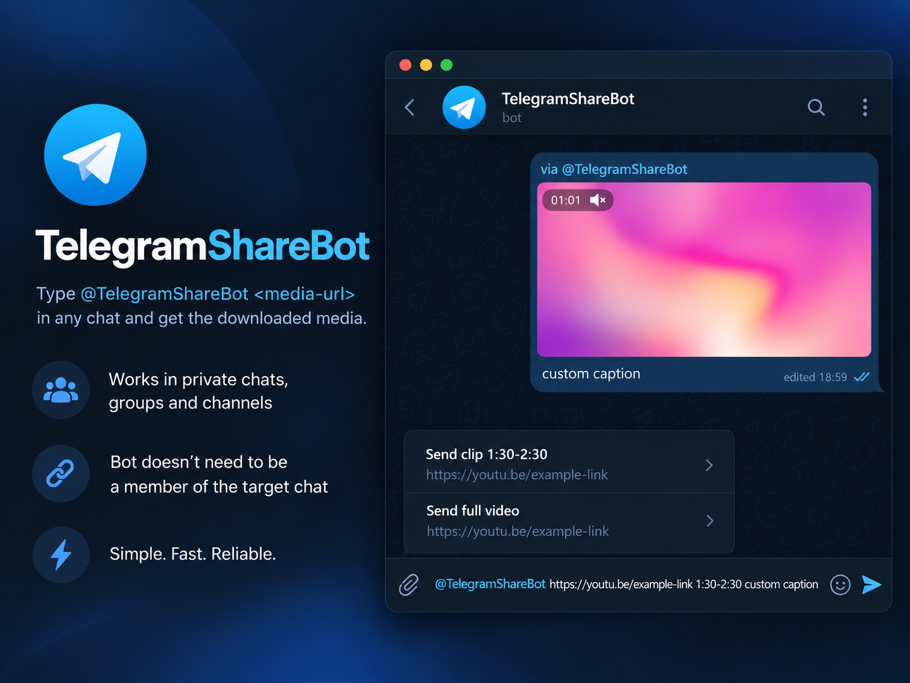

# telegram-share-bot



Share videos, audio, YouTube clips, and TikTok photo slideshows directly in Telegram. Send a link to the bot in a private chat, or use `@YourBot <url>` to share media in another chat without adding the bot to it.

## Features

- Download video or audio from YouTube, TikTok, Instagram, X, Reddit, and Facebook.
- Share YouTube clips or full videos.
- Convert TikTok photo slideshows to video, or share their audio when available.
- Choose **Auto**, **Best**, or **Balanced** video quality.
- Reuse previously prepared media when possible.

## Setup

### 1. Create a Telegram bot

1. Open [@BotFather](https://t.me/BotFather) and use `/newbot`.
2. Copy the token for `BOT_TOKEN` in your `.env` file.
3. Enable inline mode with `/setinline`.
4. **Enable inline feedback** with `/setinlinefeedback` (100% recommended). This is required for inline media sharing to work.

### 2. Configure the bot

```bash
cp .env.example .env
```

Set these values in `.env`:

| Variable | Description |
| --- | --- |
| `BOT_TOKEN` | Token from BotFather |
| `STORAGE_CHAT_ID` | Your private Telegram user ID or a private channel the bot can access |
| `ALLOWED_USER_IDS` | Telegram user IDs allowed to use the bot (comma-separated) |

**Important:** Use a private storage chat because downloaded files are temporarily sent there. To run a public bot, explicitly set `ALLOW_PUBLIC=true` instead of restricting user IDs.

### 3. Run with Docker (recommended)

```bash
docker compose up -d
```

If Docker reports permission errors on Linux, fix the mounted directories (UID 1000) and rerun `docker compose up -d`:

```bash
mkdir -p downloads data logs
sudo chown -R 1000:1000 downloads data logs
```

Useful commands:

```bash
docker compose logs -f  # View logs
docker compose down     # Stop the bot
```

Open your bot in Telegram and send `/start` once.

## Usage

**Private chat:** Send a media URL to the bot and choose Video or Audio, or use your saved default format.

**Other chats:** Type the bot's username followed by a link, then select a result:

```text
@YourBot https://youtube.com/watch?v=...
```

For a **YouTube clip**, add a start and end time after the URL:

```text
@YourBot https://youtube.com/watch?v=... 1:20-2:05
```

You can also use a YouTube link with `?t=` or `start=` to specify the clip's start time. Inline sharing briefly shows a placeholder while the media is prepared.

Use `/settings` to customize the default format, video quality, and captions. Commands such as `/video`, `/video best`, `/video balanced`, and `/audio` override the format or quality for a single request.

## Local development

For a local Python installation, install `ffmpeg` and make it available on your `PATH`.

```powershell
python -m venv .venv
.\.venv\Scripts\Activate.ps1
pip install -r requirements-dev.txt
copy .env.example .env
# Fill in the required values in .env
python -m telegram_share_bot
```

The commands above use PowerShell on Windows. On macOS/Linux, activate the environment with `source .venv/bin/activate` and copy the environment file with `cp .env.example .env`.

## Limits and notes

- Files are prepared to fit Telegram's upload limit (approximately **45 MB** of usable output size).
- Full videos and audio are limited to **30 minutes** by default; YouTube clips to **10 minutes**.
- Supported formats and quality depend on the source. Some links may fail or exceed size and time limits.
- User preferences are saved in `./data`; back up this directory if you want to preserve them. The media cache in `./downloads` can be rebuilt.
- Only share content you have the right to download and distribute, and respect platform terms.

For detailed configuration, troubleshooting, and backup instructions, see the [operator guide](docs/README.md).
